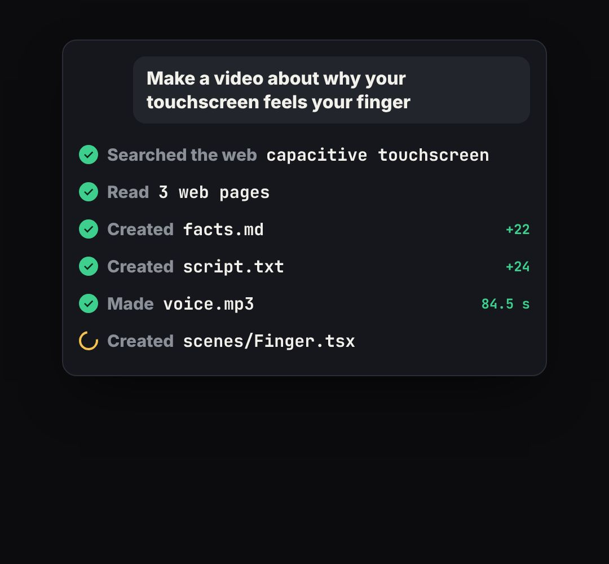

# agent-log

An AI agent's activity log ticking through its steps ("Searched the web… Created script.txt… Made voice.mp3").

- `opts`: { theme, title, prompt: the request shown at the top, steps: [{ verb, obj, meta }], w }
- `state`: { show: 0..1, n: progress in steps (2.5 = two done, the third half-way and spinning) } · api: frame(t, state)

Use: `const b = KF.make("agent-log", hostElement, opts);` then `b.frame(t, state)` on every seek.
Working example: `demo.js` (watch it with `../gallery.html?only=agent-log`).
