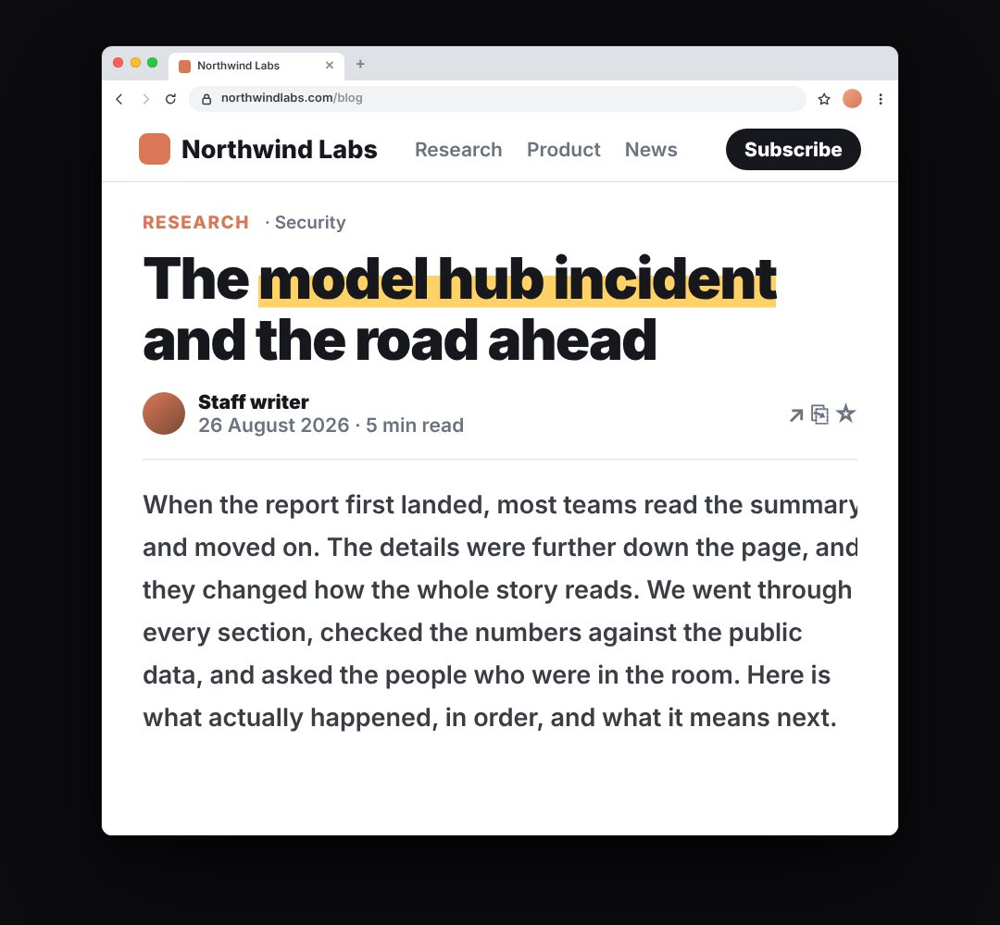

# article-card

A news / blog article in a real browser window (site bar with nav and Subscribe, section label, headline, byline with avatar and read time, readable body text) with the headline marked up (the source of a claim, shown on screen).

- `opts`: { theme: "light"|"dark", site, url, date, author, headline: "The *key words* in a headline" (the part in *stars* gets the marker), tags: [..] (first one is the section label), lines: number of body lines, body: [lines of text] (optional), w, top, chrome: false to drop the browser frame }
- `state`: { show: 0..1, mark: 0..1 (marker sweeps over the starred words), body: 0..1 (body lines draw in), scroll: px } · api: frame(t, state)

Use: `const b = KF.make("article-card", hostElement, opts);` then `b.frame(t, state)` on every seek.
Working example: `demo.js` (watch it with `../gallery.html?only=article-card`).
