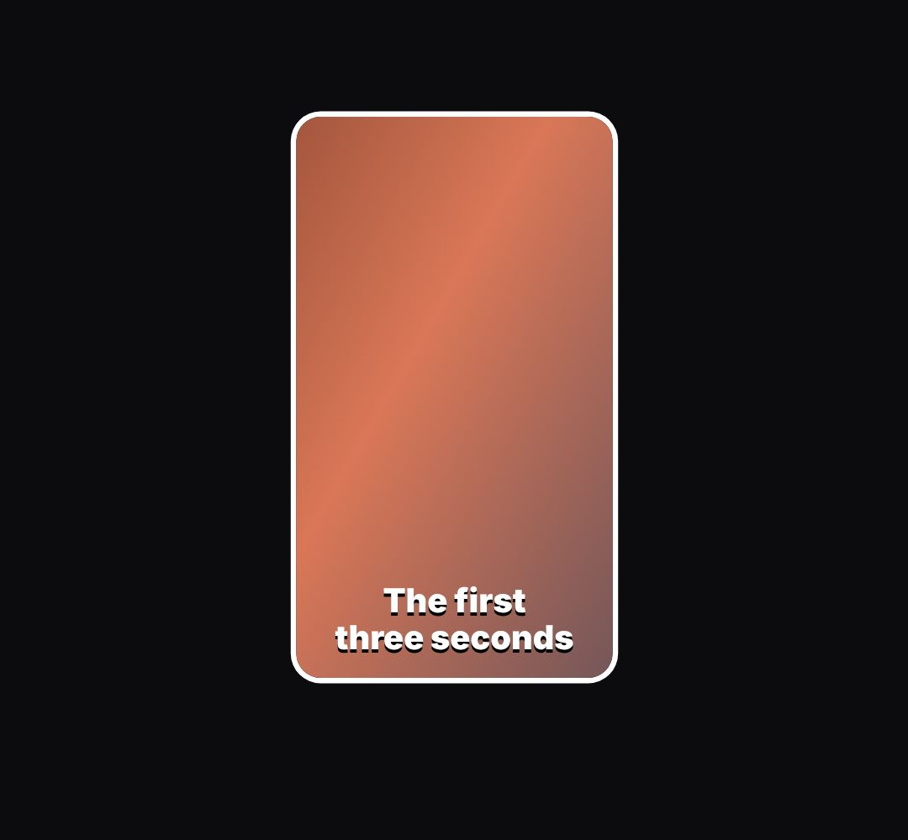

# blade-cut

Two glowing blades slice a wide picture; the sides fall away and the middle becomes a vertical clip ("it cuts them into Shorts", crop, trim).

- `opts`: { w, h (the wide picture), keep: 0..1 share of the width that stays (default 9:16 of the height), bg: css background for the picture (image url or gradient), top }
- `state`: { show: 0..1, cut: 0..1 (blades come down), fall: seconds since the sides let go (0 = still attached), grow: 0..1 (the kept piece scales up) } · api: frame(t, state) · center → the kept piece's element (paint frames or add captions inside it)

Use: `const b = KF.make("blade-cut", hostElement, opts);` then `b.frame(t, state)` on every seek.
Working example: `demo.js` (watch it with `../gallery.html?only=blade-cut`).
