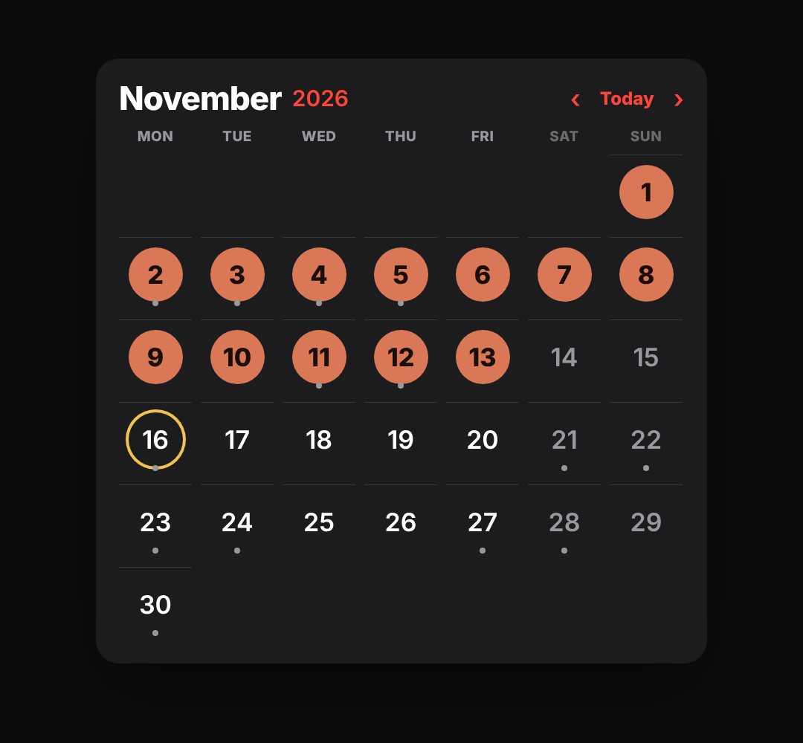

# calendar

A month view laid out like the iOS / macOS Calendar app (red year link, big month title, weekday row, hairlines between weeks, event dots, today in a red circle) where days fill in (streaks, "40 days", deadlines, a date that matters).

- `opts`: { theme, title: "November 2026", days: 30, offset: weekday of day 1 (0 = Monday), w, mark: colour, big: [day numbers ringed as key dates], top }
- `state`: { show: 0..1, fill: number of days marked so far (can be fractional), today: day number (red circle) } · api: frame(t, state) · cell(day) → [x, y] host pixels

Use: `const b = KF.make("calendar", hostElement, opts);` then `b.frame(t, state)` on every seek.
Working example: `demo.js` (watch it with `../gallery.html?only=calendar`).
