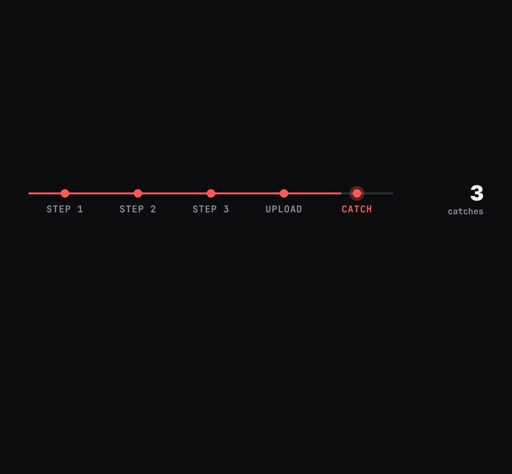

# chapter-rail

A thin progress rail with chapter dots and a live counter on the right (where am I in the video + the number that matters now).

- `opts`: { steps: ["step 1", "step 2", …], theme, color, top }
- `state`: { at: position in chapters (1.5 = half-way through the second), value: number for the counter, label: its caption, alert: bool (rail turns red: "the catch") } · api: frame(t, state)

Use: `const b = KF.make("chapter-rail", hostElement, opts);` then `b.frame(t, state)` on every seek.
Working example: `demo.js` (watch it with `../gallery.html?only=chapter-rail`).
