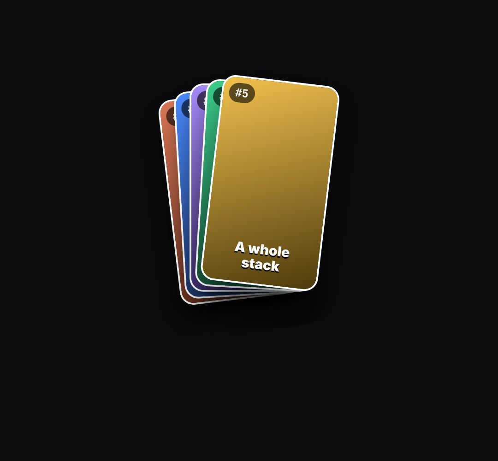

# clip-stack

Vertical clips fan out in an arc, then drop onto one stack ("a whole stack of Shorts from one video", outputs piling up).

- `opts`: { n: cards, card: [w, h], captions: [..], images: [urls], top }
- `state`: { fan: 0..1 (cards fly in and fan out), stack: 0..1 (they collapse onto one pile) } · api: frame(t, state) · cards → the card elements

Use: `const b = KF.make("clip-stack", hostElement, opts);` then `b.frame(t, state)` on every seek.
Working example: `demo.js` (watch it with `../gallery.html?only=clip-stack`).
