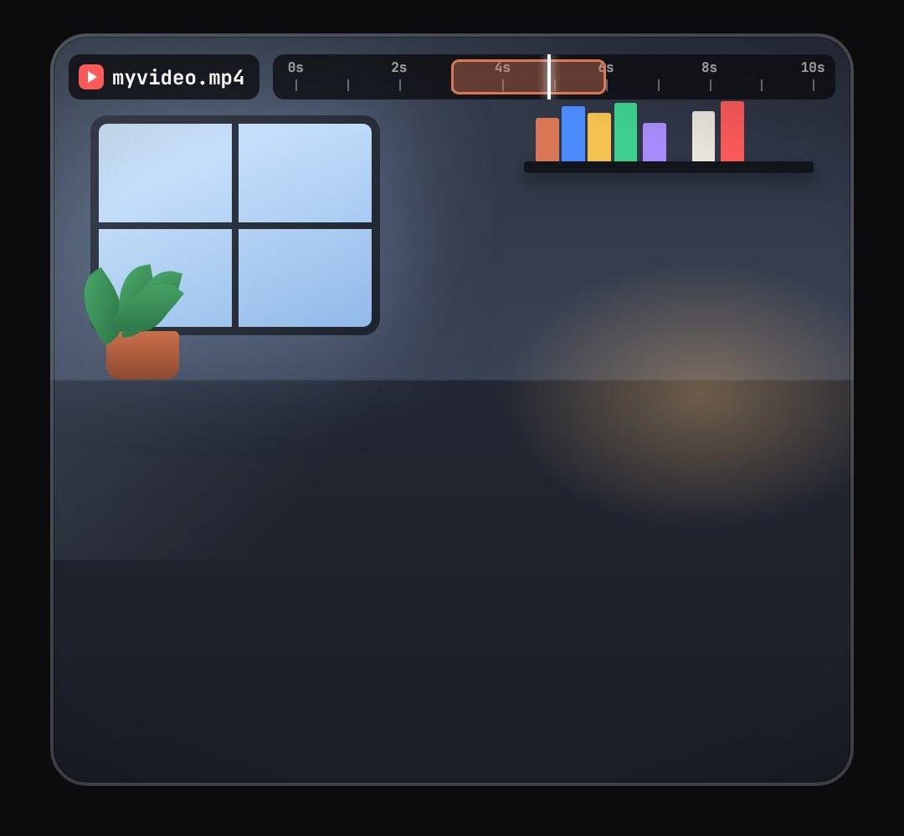

# clip-stage

"Your video" as a framed vertical clip: a room behind the person (window light, shelf, plant, lamp glow) and on top a file chip plus a small editing timeline where a time range is selected and a playhead runs ("from 3 to 6 seconds"), and an "exported" chip.

- `opts`: { chrome: host element for the top layer, file: "myvideo.mp4", total: seconds on the timeline (10), wall: colour, radius }
- `state`: { show: 0..1, range: [from, to] seconds (omit = none), sel: 0..1 (the range draws on), play: 0..1 (playhead through the range), out: "myvideo_effects.mp4" + done: 0..1 (an "exported" chip pops) } · api: frame(t, state)

Use: `const b = KF.make("clip-stage", hostElement, opts);` then `b.frame(t, state)` on every seek.
Working example: `demo.js` (watch it with `../gallery.html?only=clip-stage`). Used in the EFFECTS reel (studio/reels/effects).
