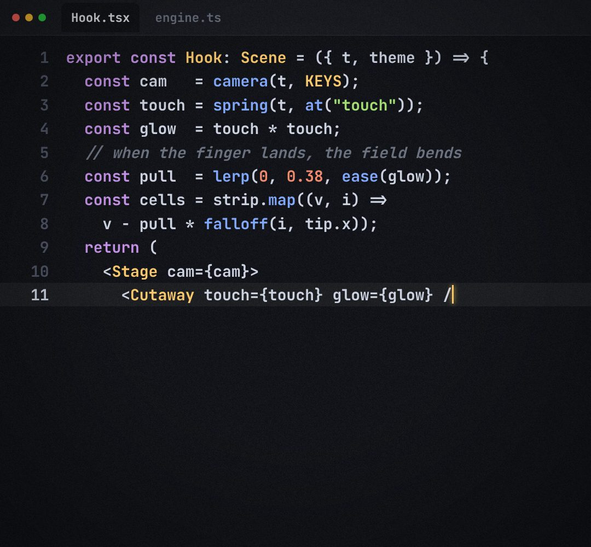

# code-reveal

The picture breaks into blocks that flip, one by one, into a real code editor showing the code that draws it ("all of this was written by Claude"); a glitch at the turn; then it can fold back.

- The editor has a title bar with tabs, line numbers, syntax colours, a current-line highlight and a blinking caret that types.
- `opts`: { code: "…" (your real source; a sample is used when missing), file: "Hook.tsx", size: font px, cell: block size px }
- `state`: { p: 0..1 (0 = picture, 1 = editor fully over it), type: 0..1 (how much of the code has been typed), scroll: px } · api: frame(t, state)
- Put this block's host ABOVE the scene it covers (same position and size).

Use: `const b = KF.make("code-reveal", hostElement, opts);` then `b.frame(t, state)` on every seek.
Working example: `demo.js` (watch it with `../gallery.html?only=code-reveal`).
