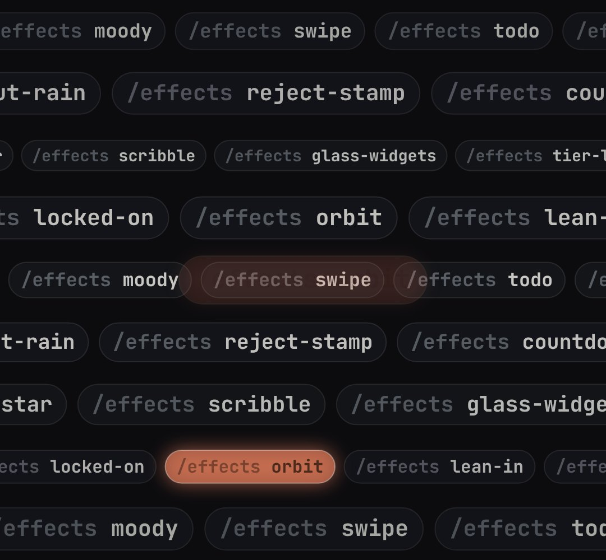

# command-wall

A wall of command chips ("/effects orbit", "/effects spotlight", …) in rows sliding past at different speeds; one chip at a time lights up and one can be pulled out big in the middle ("51 effects", every command, a list of features or prompts).

- `opts`: { names: [strings], prefix: "/effects ", rows: 7, size: font px, gap, color: highlight colour, tone: "dark"|"light" }
- `state`: { show: 0..1 (rows slide in from both sides), speed: 1, dim: 0..1 (the wall falls back), hot: index of the chip that is lit (default: one walks through the list by itself), pick: 0..1 (the hot chip grows in the middle of the wall) } · api: frame(t, state)

Use: `const b = KF.make("command-wall", hostElement, opts);` then `b.frame(t, state)` on every seek.
Working example: `demo.js` (watch it with `../gallery.html?only=command-wall`). Used in the EFFECTS reel (studio/reels/effects).
