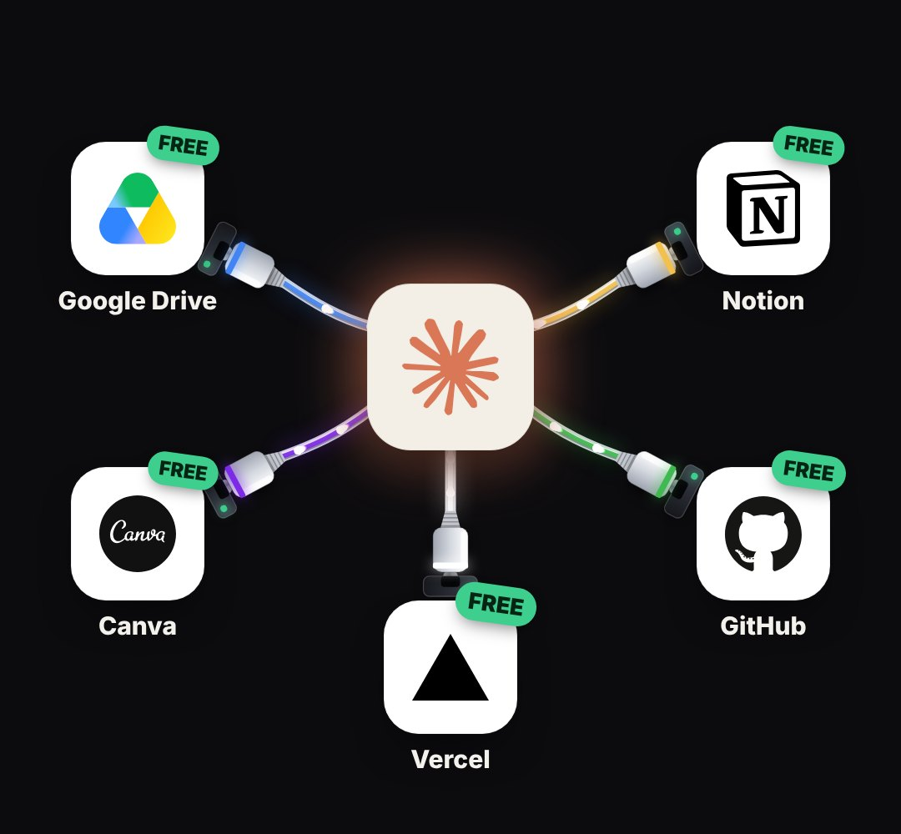

# connector-hub

One hub tile in the middle and app tiles around it, joined by real cables. Each app starts grey with its plug hanging loose; at its time the plug drives in, the tile pops into colour and packets start running ("5 apps that plug into X", connectors, integrations, an MCP hub). Load `plug-cable/block.js` first.

- `opts`: { hub: { logo, label, x, y, size, bg }, apps: [{ id, logo, label, x, y, at: time its plug seats, color, bg: tile colour }], tile: px, tone: "dark"|"light", gap }
- `state`: { show: 0..1, hot: [ids] (ringed and bigger), dim: [ids], badge: "FREE" + badgeAt: time the badges start popping (one after another), flow: 0..1, blind: 0..1 (a red "can't see" bar across the hub) }
- `api`: frame(t, state) · count(t) → how many are plugged in

Use: `const b = KF.make("connector-hub", hostElement, opts);` then `b.frame(t, state)` on every seek.
Working example: `demo.js` (watch it with `../gallery.html?only=connector-hub`).
