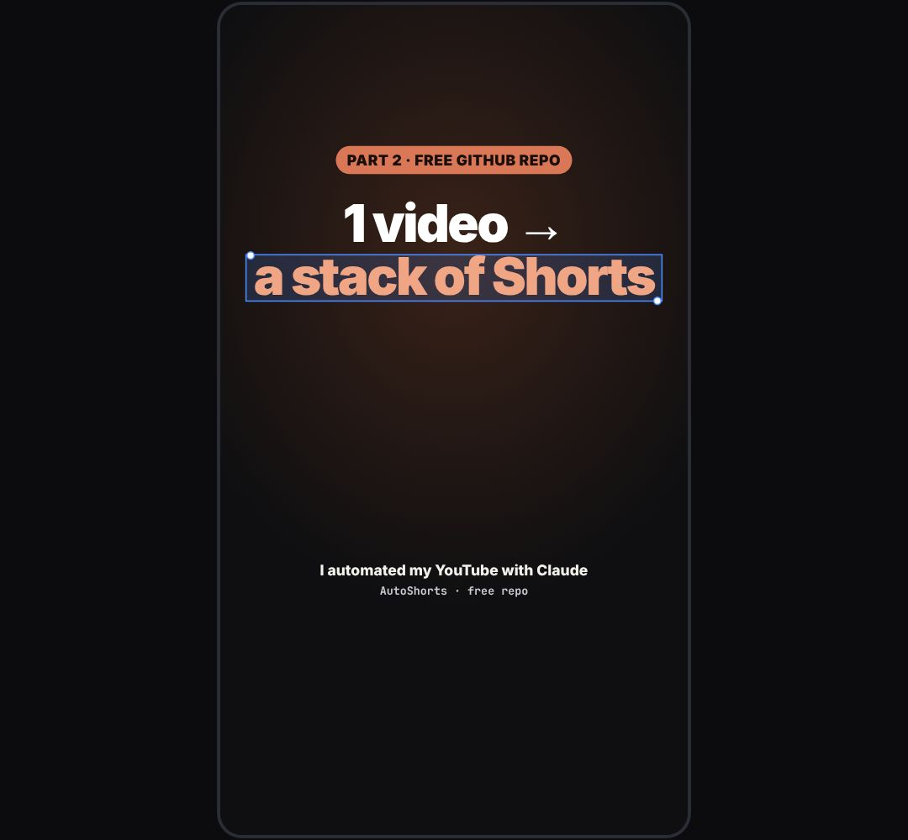

# cover

The reel cover (grid thumbnail): kicker pill, big headline with one phrase in the blue selection box, a footer line, over a darkened still.

- `opts`: { kicker, headline: "1 video → *a stack of Shorts*" (the *starred* part gets the box), foot, sub, bg: url of a still, dim: 0..1, theme }
- `api`: frame() (static; call once). Shoot it with assets/shot_cover.mjs at 1080×1920; keep the headline inside the centre 1080×1350 (the grid crop).

Use: `const b = KF.make("cover", hostElement, opts);` then `b.frame(t, state)` on every seek.
Working example: `demo.js` (watch it with `../gallery.html?only=cover`).
