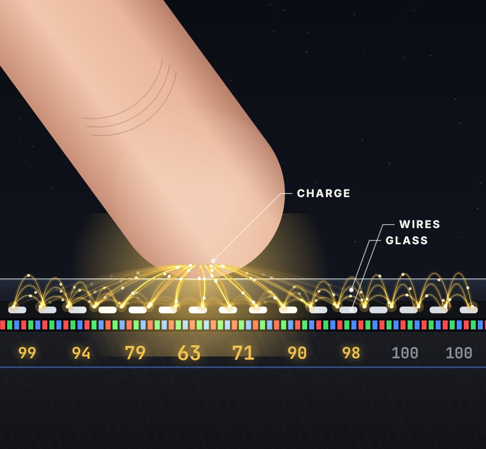

# cutaway-stage

A magnified cross-section. Layers stacked at the bottom, one hero object (finger / pen / none) coming down onto them.

- `opts`: { top: y of the first layer (default 62% of host height), hero: "finger"|"pen"|"none", heroX: 0..1,
- layers: [{ name, h, kind: "glass"|"wires"|"pixels"|"mesh"|"dots"|"solid", color }] }
- `state`: { touch: 0..1 (hero away → touching), glow: 0..1 (light where it touches), zoom: 1.., focus: [x, y] (zoom centre), heroX: 0..1 }
- `api`: frame(t, state) · anchor(name) → [x, y] in host pixels for a layer name, "tip" (hero tip) or "hero" (hero body) — feed these to tracked-labels

Use: `const b = KF.make("cutaway-stage", hostElement, opts);` then `b.frame(t, state)` on every seek.
Working example: `demo.js` (watch it with `../gallery.html?only=cutaway-stage`).
