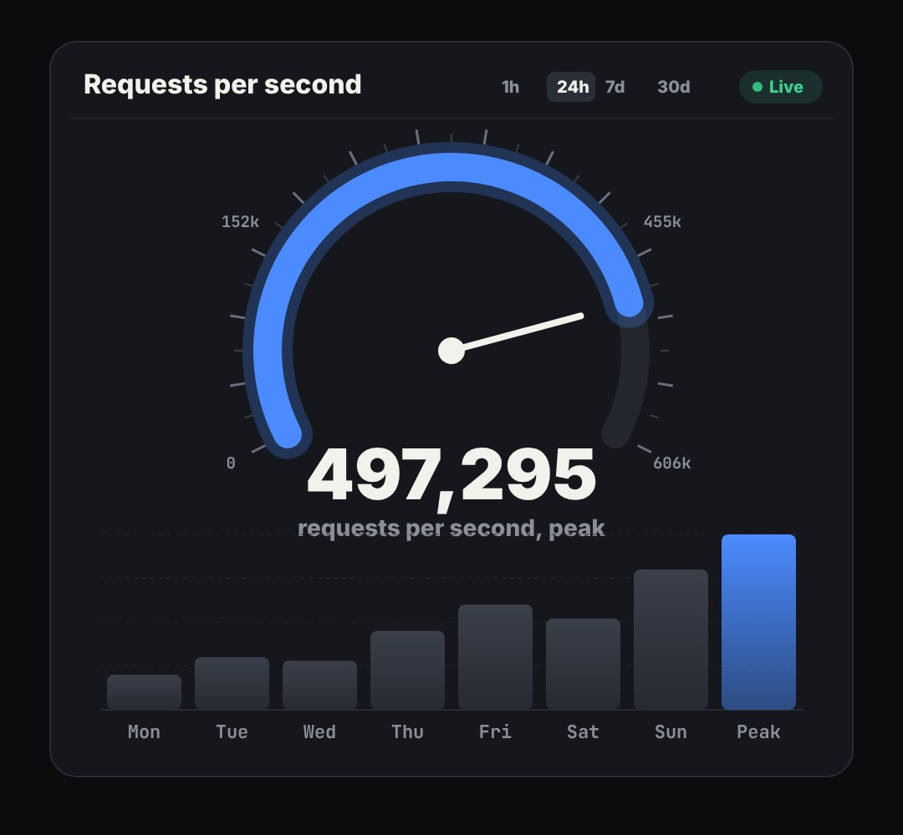

# dashboard

A monitoring dashboard panel (gauge with a tick scale, rolling total, bar chart on grid lines, time-range tabs, Live chip) (traffic, revenue, usage: "the numbers went up").

- `opts`: { title, unit, max: gauge maximum, total: final big number, bars: [..] heights 0..1, labels: [..], color }
- `state`: { p: 0..1 (everything animates in together), gauge: 0..1 (override), total: number (override), hi: index of the bar to highlight } · api: frame(t, state)

Use: `const b = KF.make("dashboard", hostElement, opts);` then `b.frame(t, state)` on every seek.
Working example: `demo.js` (watch it with `../gallery.html?only=dashboard`).
