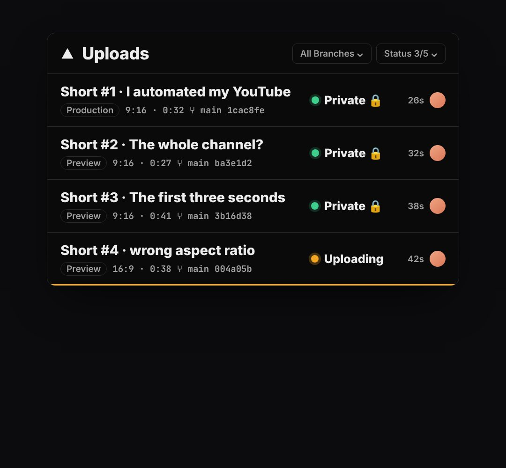

# deploy-list

A list of jobs that go from "building" to "ready" one by one (deployments, uploads, exports, tests), laid out like a hosting dashboard's Deployments page: black panel, hairline rows, status dot + label, branch and commit, age and avatar.

- `opts`: { theme, title, rows: [{ name, sub, at: time it appears, done: time it turns ready, fail: bool, env: "Production"|"Preview" }], w, top }
- `state`: { busy: "Building", ok: "Ready", bad: "Error" } (labels, optional) · api: frame(t, state)

Use: `const b = KF.make("deploy-list", hostElement, opts);` then `b.frame(t, state)` on every seek.
Working example: `demo.js` (watch it with `../gallery.html?only=deploy-list`).
