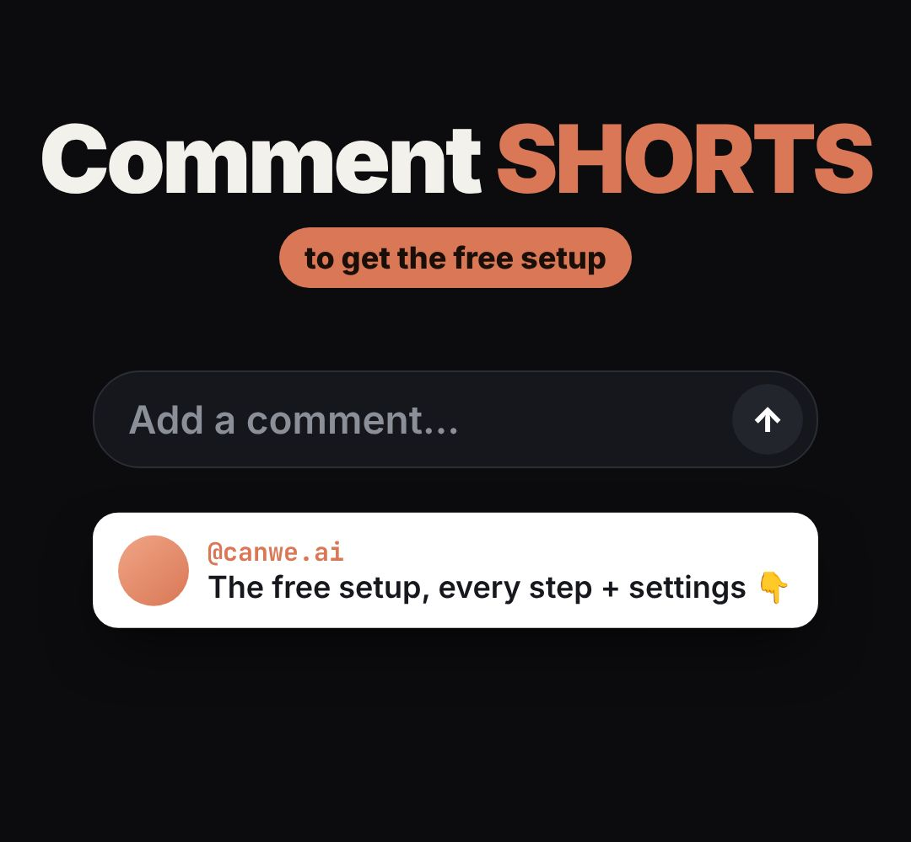

# ending-comment

The "Comment KEYWORD" ending: big call to action, the keyword typed into a comment box and sent, then our DM reply drops in.

- `opts`: { keyword: "SHORTS", pill: "to get the free setup", handle: "@canwe.ai", dm: "The free setup, every step 👇", logo: url, theme }
- `state`: { show: 0..1, typed: 0..1, sent: 0..1, dm: 0..1 } · api: frame(t, state)

Use: `const b = KF.make("ending-comment", hostElement, opts);` then `b.frame(t, state)` on every seek.
Working example: `demo.js` (watch it with `../gallery.html?only=ending-comment`).
