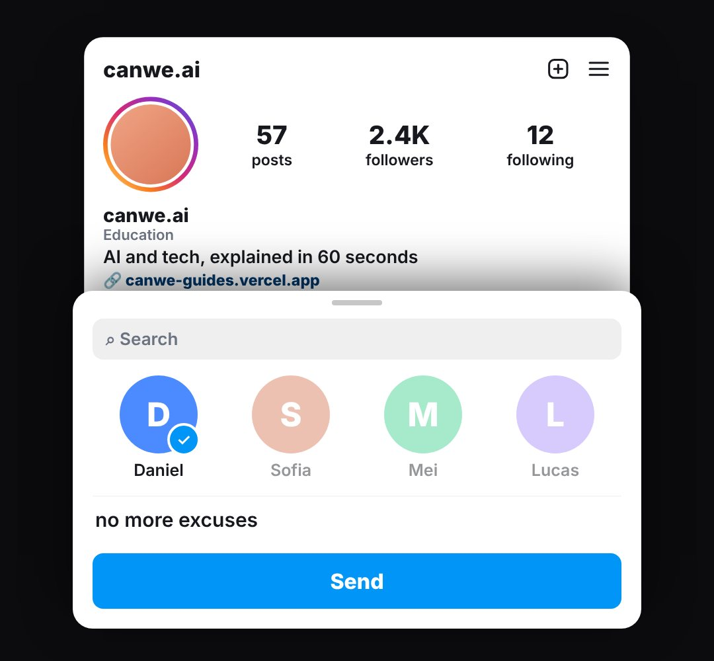

# ending-follow

The closing card, laid out like the Instagram app: a profile (story-ring avatar, stats, bio, link, Follow / Message buttons, grid) with a Follow button that gets tapped, then a share sheet sending the reel to a friend ("follow for more, and send this to the friend who…").

- `opts`: { handle: "canwe.ai", name, bio, stats: [["246", "posts"], ["68K", "followers"], ["209", "following"]], logo: url, friends: ["Daniel", "Sofia", "Mei", "Lucas"], pick: index, message, theme, category, link, verified: true only if the account really has the badge }
- `state`: { show: 0..1, follow: 0..1 (button press → "Following"), sheet: 0..1 (share sheet slides up), picked: 0..1 (a friend gets selected), typed: 0..1 (message types), sent: 0..1 } · api: frame(t, state)

Use: `const b = KF.make("ending-follow", hostElement, opts);` then `b.frame(t, state)` on every seek.
Working example: `demo.js` (watch it with `../gallery.html?only=ending-follow`).
