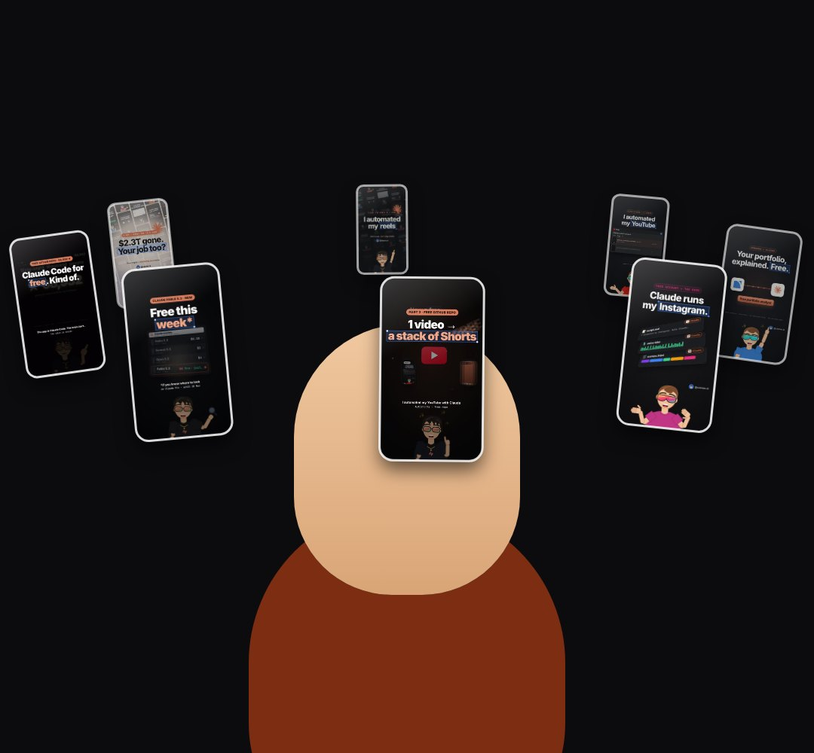

# face-fx

Creator-style video effects that follow a face, split into a layer behind the person and a layer in front: `orbit` (real reel covers circle the head), `spotlight` (lights drop, a cone keeps the person lit), `locked` (target brackets snap on and track), `stamp` (a red rubber stamp slams down).

- `opts`: { front: host element for the front layer, images: [urls] for orbit (default: our reel covers), word: stamp text ("REJECTED"), label: locked label ("LOCKED ON") }
- `state`: { fx, p: 0..1 (how far the effect is in), face: [x, y] in host px, r: face radius, at: [x, y] where the stamp lands, t0: time the stamp hits } · api: frame(t, state)

Use: `const b = KF.make("face-fx", hostElement, opts);` then `b.frame(t, state)` on every seek.
Working example: `demo.js` (watch it with `../gallery.html?only=face-fx`). Used in the EFFECTS reel (studio/reels/effects).
