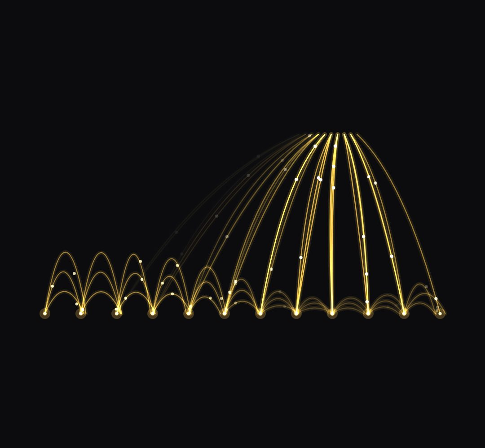

# field-arcs

glowing arcs jumping between a row of points, with sparks running along them. A "sink" (finger, hand, magnet) pulls the nearby arcs toward it.

- `opts`: { y: baseline, x0, x1, n: number of points, color, rise: arc height, lanes: arcs per gap (1..3) }
- `state`: { power: 0..1 (how alive the field is), sink: { x, y, k: 0..1 pull, r: reach in px }, speed }
- `api`: frame(t, state) · stolen(i) → 0..1 how much the sink takes from point i (use it to drive value-strip)

Use: `const b = KF.make("field-arcs", hostElement, opts);` then `b.frame(t, state)` on every seek.
Working example: `demo.js` (watch it with `../gallery.html?only=field-arcs`).
