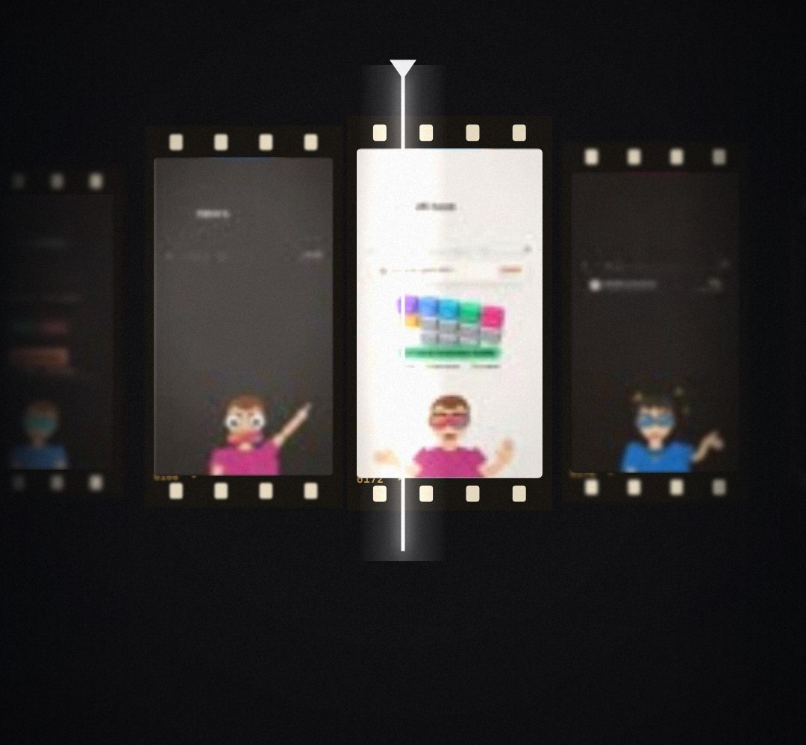

# film-strip

A long video as a real strip of film: dark celluloid with sprocket holes, frame numbers and grain, holding REAL frames (default: our own reel frames), curving away in perspective as it runs under a glowing playhead. The best moments get bracketed, light up with a score and lift out of the strip.

- `opts`: { n: frames, images: [urls] (else frames from keyframes/_assets/frames.jpg), picks: [frame indexes], scores: [numbers], y, frame: [w, h] }
- `state`: { show: 0..1, scroll: 0..1 (how far the strip has run), lift: 0..1 (the picked frames rise out) } · api: frame(t, state)

Use: `const b = KF.make("film-strip", hostElement, opts);` then `b.frame(t, state)` on every seek.
Working example: `demo.js` (watch it with `../gallery.html?only=film-strip`).
