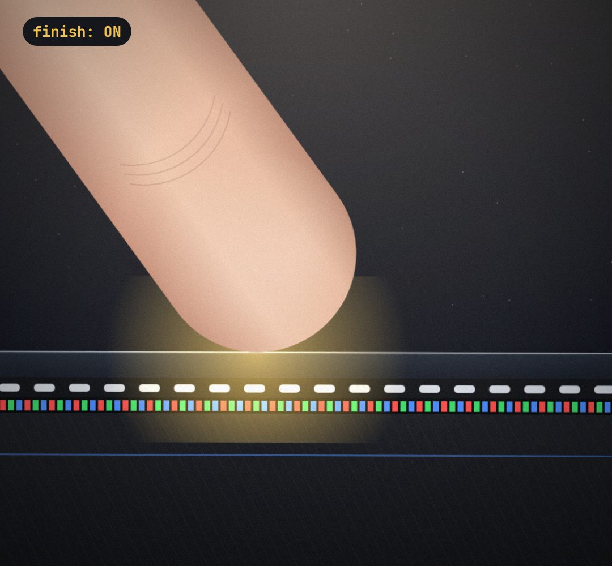

# finish

The camera-lens layer that makes drawn scenes feel filmed: film grain, a vignette, a faint lens bloom and (optional) a slow handheld drift you apply to your scene.

- `opts`: { grain: 0..1 strength (default 0.5), vignette: 0..1 (default 0.6), tint: colour of the bloom }
- `state`: { bloom: 0..1 (a soft glow from the top, e.g. on a big reveal), flash: 0..1 (white flash, e.g. on a cut) } · api: frame(t, state) · drift(t, amount) → [dx, dy, rotDeg] for a handheld feel
- Put its host on TOP of the scene (same size), pointer-events none. Grain changes 24 times a second, like film.

Use: `const b = KF.make("finish", hostElement, opts);` then `b.frame(t, state)` on every seek.
Working example: `demo.js` (watch it with `../gallery.html?only=finish`).
