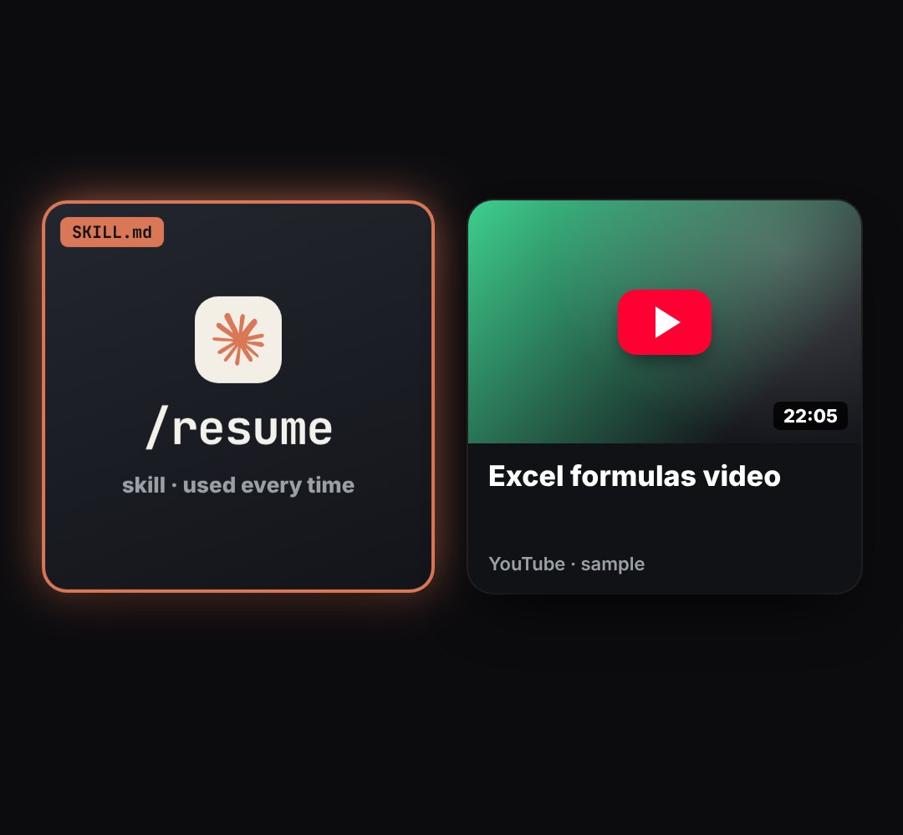

# flip-cards

Cards that turn over in 3D to show what a thing becomes: front = a video thumbnail (play button, title, duration), back = the result (a skill cartridge with a logo tile and a big command). Lift, spin, light flare, bounce.

- `opts`: { items: [{ title, dur: "15:20", color, cmd: "/resume", sub: "skill · used every time", at: time it appears, flip: time it turns }], w, h, gap, top, logo: url for the back tile, tag: small label on the back ("SKILL.md") }
- `state`: { show: 0..1 } · api: frame(t, state)

Use: `const b = KF.make("flip-cards", hostElement, opts);` then `b.frame(t, state)` on every seek.
Working example: `demo.js` (watch it with `../gallery.html?only=flip-cards`). Used in the LEARN reel (studio/reels/learn).
