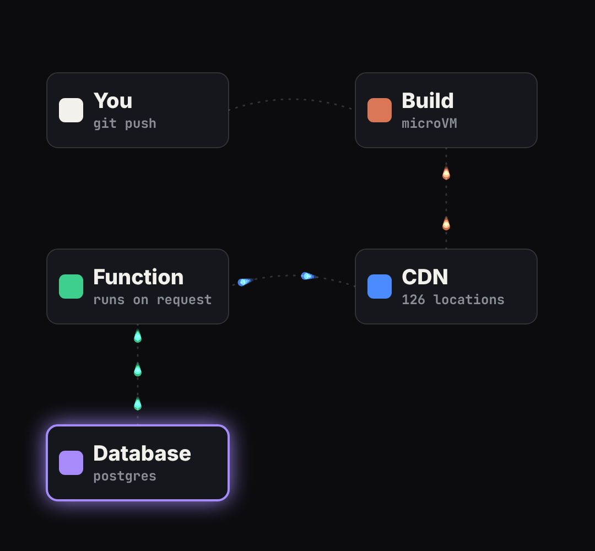

# flow-nodes

Boxes joined by wires with packets travelling along them (request → server → database, a pipeline, "how X talks to Y").

- `opts`: { nodes: [{ id, label, sub, x, y, w, h, color, at }], edges: [{ from, to, at: time packets start, until, color, rate: packets per second, bend }] }
- `state`: { active: [ids] (boxes that glow), dim: [ids] } · api: frame(t, state) · center(id) → [x, y]

Use: `const b = KF.make("flow-nodes", hostElement, opts);` then `b.frame(t, state)` on every seek.
Working example: `demo.js` (watch it with `../gallery.html?only=flow-nodes`).
