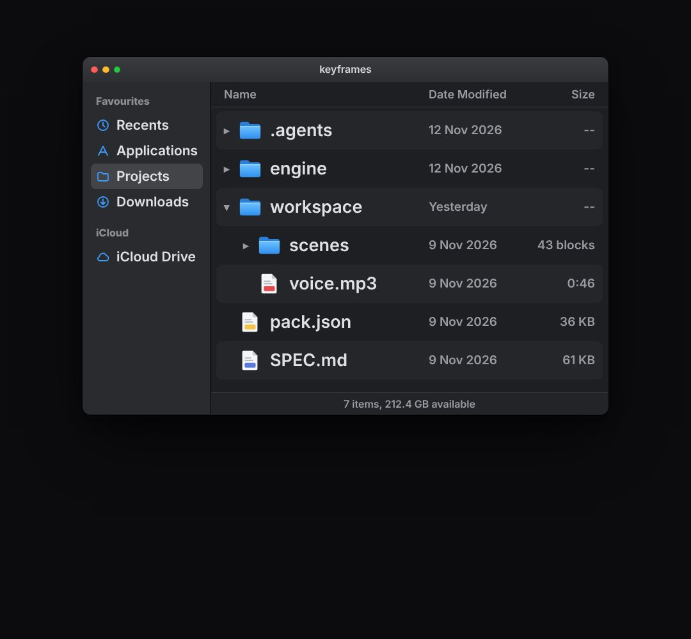

# folder-window

A macOS Finder window in list view (sidebar, Name / Date Modified / Size columns, real folder and document icons, blue selection) whose files appear one by one ("with this folder…", project structure, what's inside the download).

- `opts`: { title, files: [{ name, dir: bool, depth: 0.., note (shown in the Size column), date }], w, h, top, sidebar: false to hide it }
- `state`: { show: 0..1, n: how many rows are visible (fractional = the next one is sliding in), hot: index of the selected row } · api: frame(t, state)

Use: `const b = KF.make("folder-window", hostElement, opts);` then `b.frame(t, state)` on every seek.
Working example: `demo.js` (watch it with `../gallery.html?only=folder-window`).
