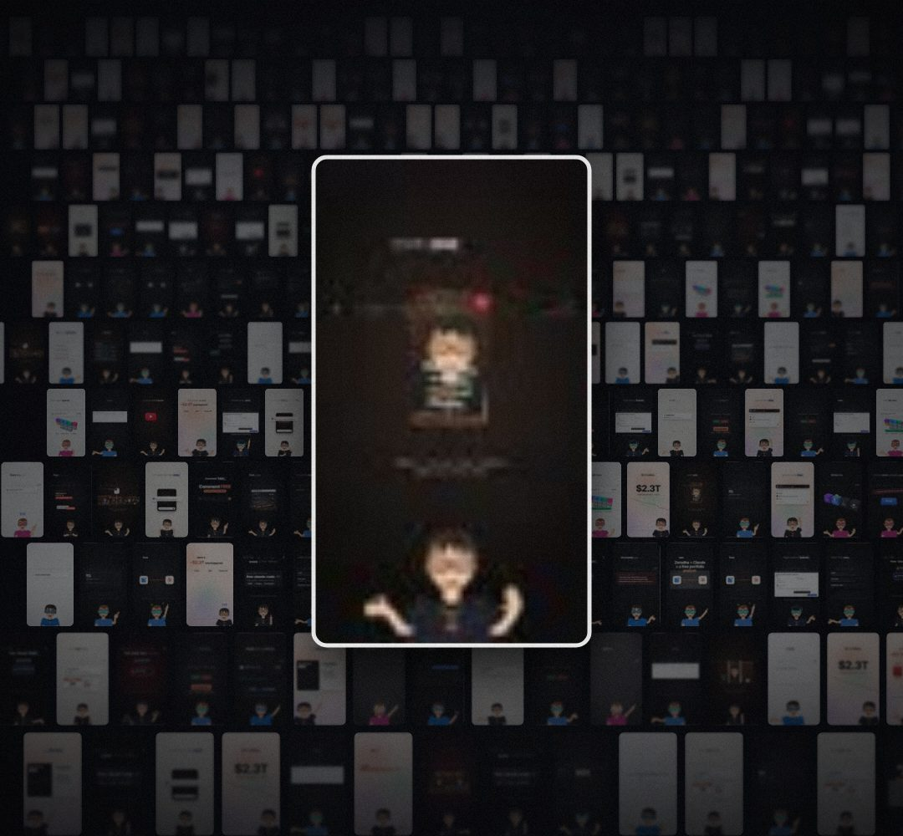

# frame-wall

A wall of thousands of REAL video frames, seen at an angle like a wall of prints: rows recede into the distance, far rows are out of focus, a light sweeps across, and one frame can fly out of the wall toward the camera ("over 5,000 frames, one by one").

- `opts`: { sheet: url of a frame sheet (default: keyframes/_assets/frames.jpg, 96 frames from our own reels, 12×8), grid: [cols, rows] of the sheet, tile: [w, h] of the nearest row, focusFrame: sheet index of the frame that flies out }
- `state`: { fill: 0..1 (the wall draws itself in, far to near), speed, dim: 0..1, focus: 0..1 (one frame leaves the wall, turns, and lands big in the middle), sweep: 0..1 (a light band crossing the wall) } · api: frame(t, state) · total → tiles on screen

Use: `const b = KF.make("frame-wall", hostElement, opts);` then `b.frame(t, state)` on every seek.
Working example: `demo.js` (watch it with `../gallery.html?only=frame-wall`).
