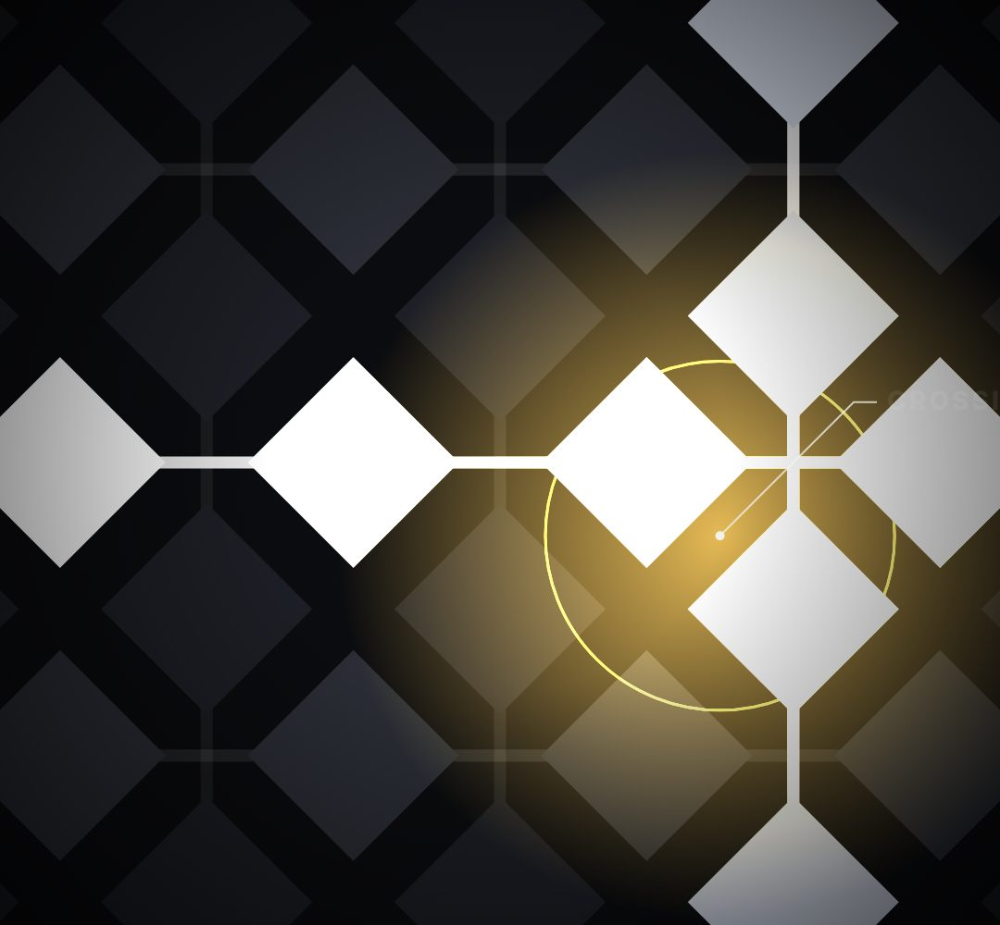

# grid-zoom

a woven grid of rows and columns (sensor grid, pixel grid, city blocks, seats). Light up one row, one column, then fly into their crossing.

- `opts`: { cell: px, tilt: 0..1 (lay the grid back in perspective), rowColor, colColor }
- `state`: { row: index, rowP: 0..1 sweep, col: index, colP: 0..1, zoom: 1..6, pulse: 0..1 glow on the crossing, drift: px slow pan }
- `api`: frame(t, state) · crossing() → [x, y] host pixels of the lit crossing (for labels / magnifier)

Use: `const b = KF.make("grid-zoom", hostElement, opts);` then `b.frame(t, state)` on every seek.
Working example: `demo.js` (watch it with `../gallery.html?only=grid-zoom`).
