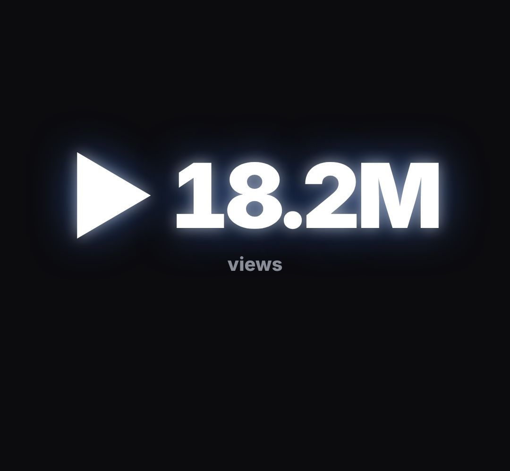

# hero-stat

One huge glowing number that rolls up (views, users, money, "18.2M").

- `opts`: { from, to, dec: decimals, prefix: "▶ " | "$", suffix: "M", label: "views", color, size, top }
- `state`: { p: 0..1 (count progress), value: number (override), show: 0..1 } · api: frame(t, state)

Use: `const b = KF.make("hero-stat", hostElement, opts);` then `b.frame(t, state)` on every seek.
Working example: `demo.js` (watch it with `../gallery.html?only=hero-stat`).
