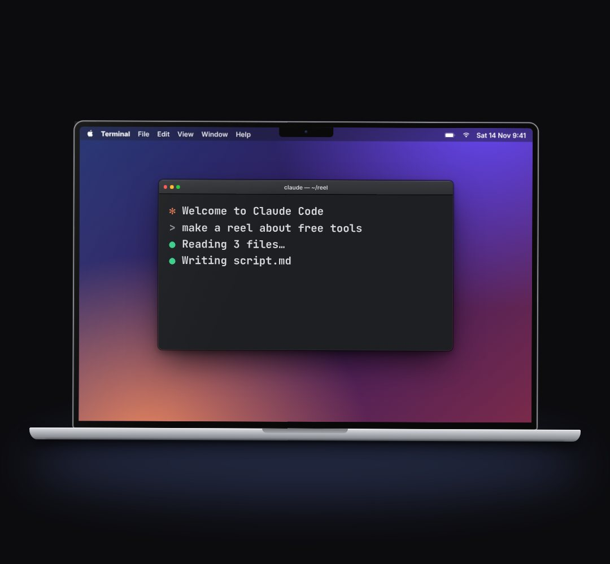

# laptop-frame

A MacBook (KF.device: thin black bezel, camera notch, aluminium front lip with the thumb scoop) whose lid opens, with your own content on the screen.

- `opts`: { w: lid width px (default 860), x (centre), top, wallpaper: css background for the empty desktop, menubar: false | "App name" (draws the macOS menu bar) }
- `state`: { show: 0..1 (rises in), open: 0..1 (lid swings up; default 1), tilt: degrees, glow: 0..1 (screen light spilling onto the desk) }
- `api`: frame(t, state) · screen → the element to put content in (it is 16:10; screenW / screenH give its size in px)

Use: `const b = KF.make("laptop-frame", hostElement, opts);` then `b.frame(t, state)` on every seek.
Working example: `demo.js` (watch it with `../gallery.html?only=laptop-frame`).
