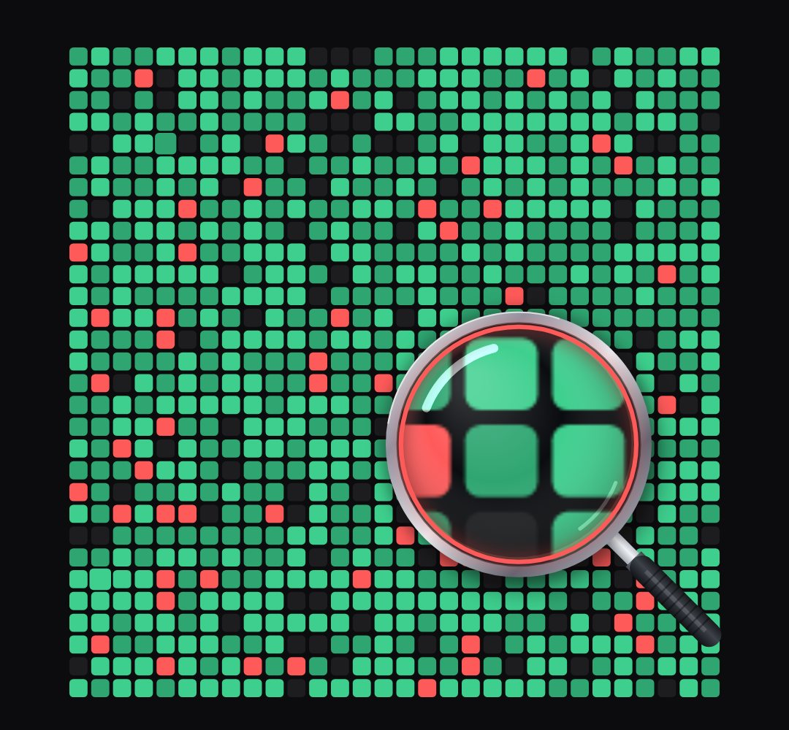

# magnifier

A real magnifying glass (chrome rim, glass reflections and colour fringe, ferrule and ribbed black handle, soft shadow on the page) that travels over another picture and shows it enlarged (inspect, review, "look closer").

- `opts`: { source: a <canvas> or  the same size as this host (e.g. another block's canvas: host.querySelector("canvas")), r: lens radius, zoom, handle: true }
- `state`: { x, y: lens centre in host pixels, show: 0..1, r, zoom, ring: colour (e.g. red when it finds a fault, green when fixed) }
- `api`: frame(t, state)

Use: `const b = KF.make("magnifier", hostElement, opts);` then `b.frame(t, state)` on every seek.
Working example: `demo.js` (watch it with `../gallery.html?only=magnifier`).
