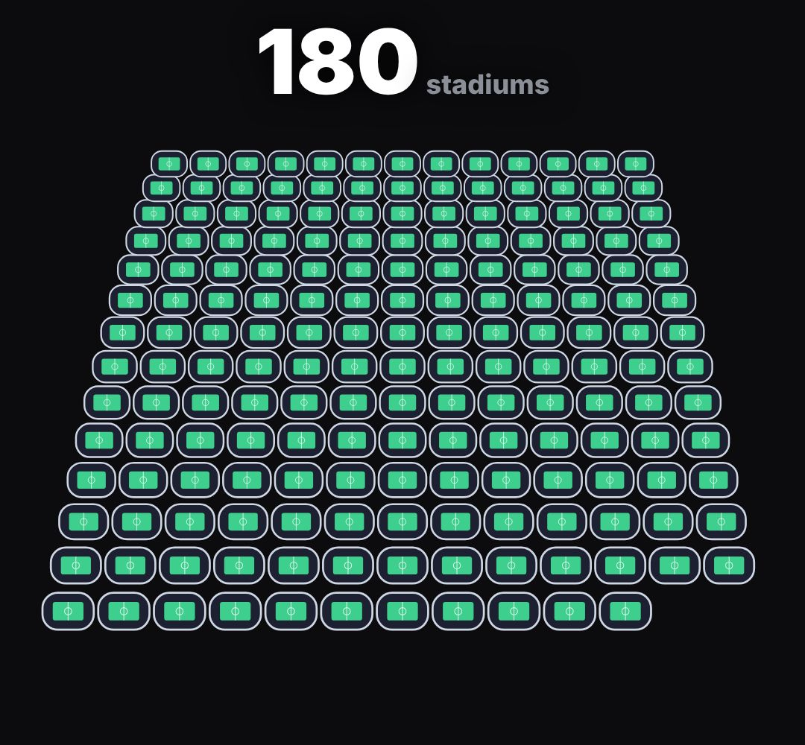

# multiply-field

One thing becomes a whole field of them ("that's 180 full stadiums", 700 agents, 5,000 people) laid back in perspective.

- `opts`: { n: how many, glyph: "stadium"|"person"|"box"|"chip"|any emoji / text, cols, color, tilt: 0..1 }
- `state`: { p: 0..1 (0 = one big item, 1 = the full field), show: 0..1 } · api: frame(t, state) · count(state) → how many are on screen (for a counter)

Use: `const b = KF.make("multiply-field", hostElement, opts);` then `b.frame(t, state)` on every seek.
Working example: `demo.js` (watch it with `../gallery.html?only=multiply-field`).
