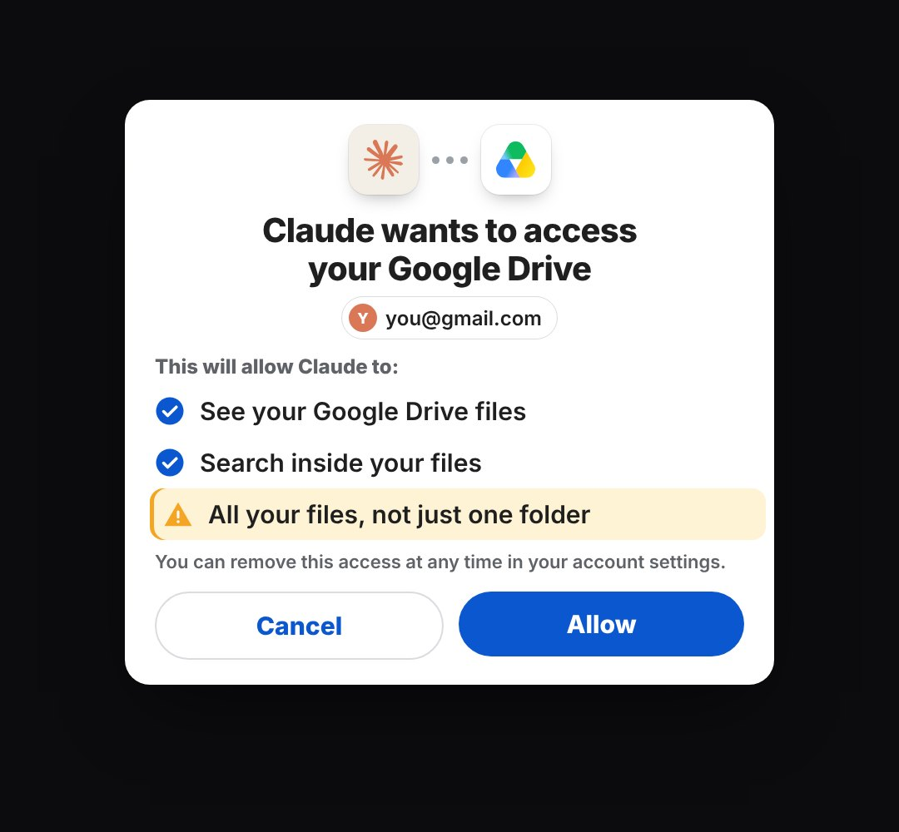

# permission-sheet

The "X wants to access your Y" consent screen you get when you connect an app, laid out like a Google / OAuth permission page (two app icons joined by a dotted link, account chip, list of permissions, note, Cancel and Allow). The rows can be read one by one and Allow can be pressed.

- `opts`: { who: "Claude", app: "Google Drive", whoLogo, appLogo, account: "you@gmail.com", rows: [{ text, sub, warn: true (amber "check this" row) }], note, w, top, theme: "light"|"dark", allow: "Allow", cancel: "Cancel" }
- `state`: { show: 0..1, read: 0..rows (rows read so far; the row being read is highlighted), allow: 0..1 (the Allow press) } · api: frame(t, state)

Use: `const b = KF.make("permission-sheet", hostElement, opts);` then `b.frame(t, state)` on every seek.
Working example: `demo.js` (watch it with `../gallery.html?only=permission-sheet`).
