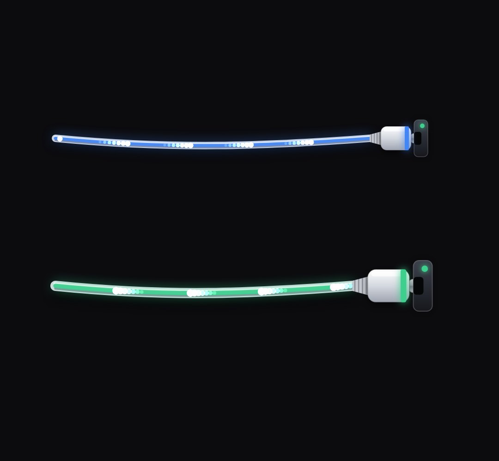

# plug-cable

A real cable with a plug that drives into a socket: slack while unplugged, a wind-up and thrust, sparks and a shock ring on the hit, the socket LED turns green and light packets run along the cable (connect X to Y, "plug it in", a connector, an integration).

- `opts`: { from: [x, y] (where the cable starts), to: [x, y] (the socket mouth), color, tone: "dark"|"light" (the background it sits on), sag: px of slack, gap: px the plug waits back, thick, socket: false to draw no socket plate, packets: per second }
- `state`: { show: 0..1, at: time the plug seats (the block does the wind-up, thrust and recoil itself), out: time it is pulled back out (optional), p: 0..1 (override: 0 = waiting, 1 = seated), flow: 0..1 (packet brightness), color, back: true = packets run to → from }
- `api`: frame(t, state) · KF.drawCable(ctx, t, spec) is the shared painter (connector-hub uses it): spec = { from, to, p, power, flow, color, tone, sag, gap, thick, hitAt, socket, seed, back }

Use: `const b = KF.make("plug-cable", hostElement, opts);` then `b.frame(t, state)` on every seek.
Working example: `demo.js` (watch it with `../gallery.html?only=plug-cable`).
