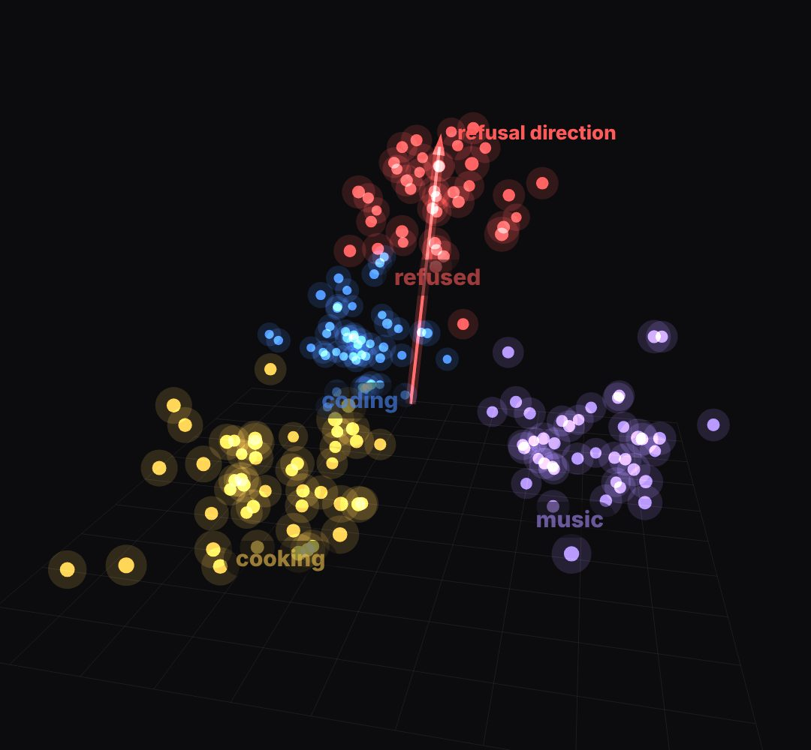

# point-cloud

clusters of dots in 3D space that the camera orbits (embeddings, customers, "things that are similar sit together").

- `opts`: { clusters: [{ name, color, center: [x, y, z] (−1..1), n, spread }], scale: px per unit, floor: true }
- `state`: { rot: radians (orbit), pitch, show: 0..1 (dots arrive), names: 0..1 (cluster names), arrow: { from: [x,y,z], to: [x,y,z], p: 0..1, color, label },
- `lift`: { i: cluster index, y: amount } , squash: 0..1 (remove the arrow's direction from every dot: the "abliteration" move) }
- `api`: frame(t, state) · project([x,y,z]) → [x, y] host pixels

Use: `const b = KF.make("point-cloud", hostElement, opts);` then `b.frame(t, state)` on every seek.
Working example: `demo.js` (watch it with `../gallery.html?only=point-cloud`).
