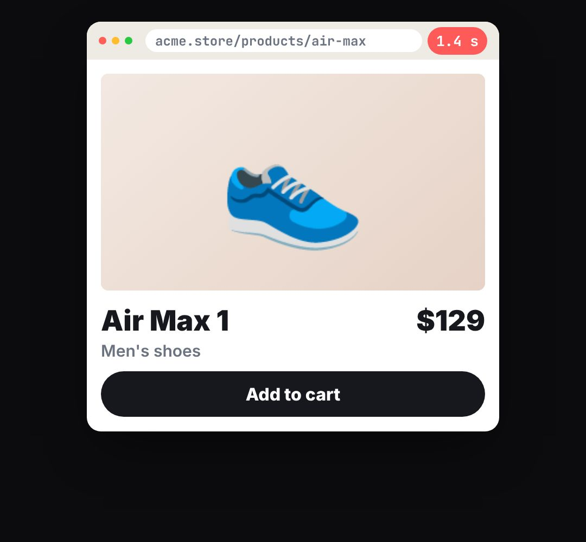

# product-page

A shop / app page in a browser that loads (skeleton → content), with a load timer ("the page took 1.4 s", pricing, "what the user sees").

- `opts`: { theme, url, title, sub, price, cta, emoji: the product picture (an emoji or short text), tint, w }
- `state`: { show: 0..1, load: 0..1 (0 = grey skeleton, 1 = fully loaded), ms: number shown in the timer chip (hidden when undefined), slow: bool (timer turns red) } · api: frame(t, state)

Use: `const b = KF.make("product-page", hostElement, opts);` then `b.frame(t, state)` on every seek.
Working example: `demo.js` (watch it with `../gallery.html?only=product-page`).
