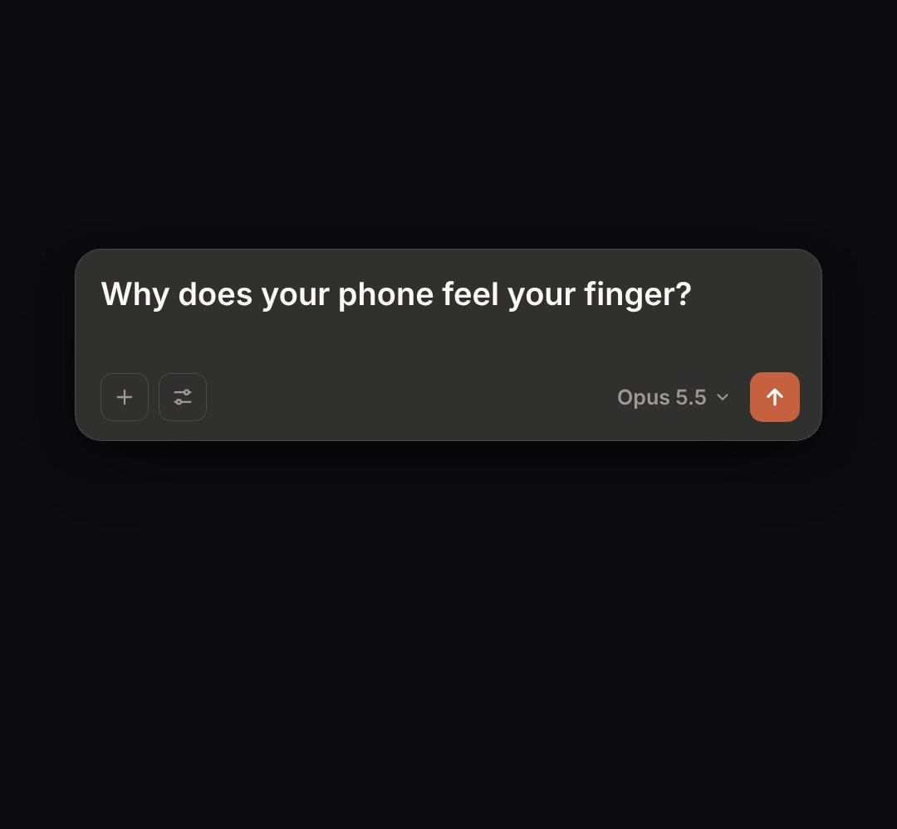

# prompt-box

The Claude chat input being typed into and sent ("just one sentence"). Laid out like claude.ai: warm dark box, + and tools buttons, model name, orange send button.

- `opts`: { theme: "dark"|"light", text: what gets typed, placeholder, model: "Opus 5.5", w, top, greeting: a line above the box (e.g. "What can I help with?") }
- `state`: { show: 0..1, typed: 0..1 (share of the text typed), send: 0..1 (the send button press; text clears after it) } · api: frame(t, state)

Use: `const b = KF.make("prompt-box", hostElement, opts);` then `b.frame(t, state)` on every seek.
Working example: `demo.js` (watch it with `../gallery.html?only=prompt-box`).
