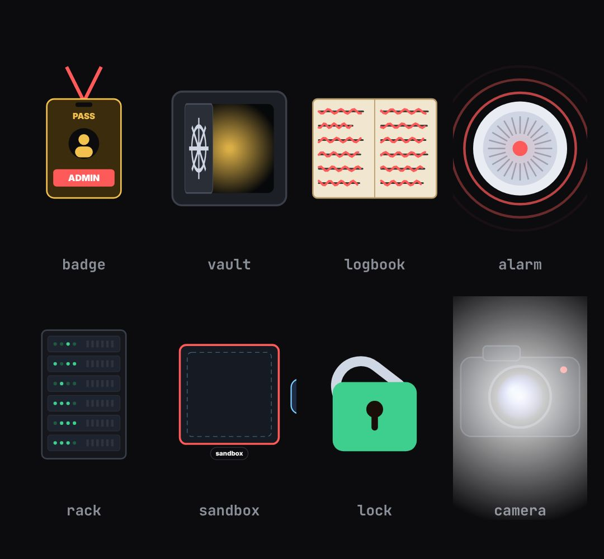

# props

Small drawn objects used as metaphors. One block, pick the object with `kind`.

- `opts`: { kind: "badge"|"vault"|"logbook"|"alarm"|"rack"|"sandbox"|"lock"|"camera", size: px, x, y (centre; default middle of the host), text, text2 }
- `state`: { p: 0..1 the object's own action (badge flips READ-ONLY → ADMIN, vault opens, logbook lines get rewritten, alarm goes off, rack lights up, sandbox is breached, lock opens, camera flashes), show: 0..1 }
- `api`: frame(t, state)

Use: `const b = KF.make("props", hostElement, opts);` then `b.frame(t, state)` on every seek.
Working example: `demo.js` (watch it with `../gallery.html?only=props`).
