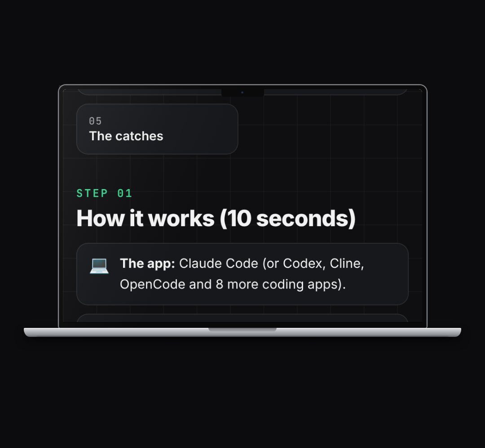

# real-screen

A REAL screenshot shown in a device frame (phone, browser or app window) that scrolls, zooms into exact spots and draws highlight boxes on them, so viewers see the actual page, button or line ("this is the repo", "click here", "this is the model it really uses").

- Coordinates are in the screenshot's own pixels, so boxes land exactly on the real thing.
- `opts`: { safeLeft: px from the host's left edge that box labels never cross (default 72, the Reels safe margin), src: image url, natural: [w, h] of the image, frame: "phone"|"laptop"|"browser"|"window" (real devices from KF.device; "laptop" has a fixed 16:10 screen so vh is ignored), tab, title, dark: false for a light browser, url: text in the browser bar, w: frame width px, vh: visible height px (phone/browser crop; default = whole image), top, x (centre) }
- `state`: { show: 0..1, scroll: y in image px at the top edge, zoom: 1.., focus: [x, y] image px kept in the middle while zoomed, dim: 0..1 (darken everything outside the active box),
- boxes: [{ x, y, w, h (image px), p: 0..1 draw-in, color, label, side: "top"|"bottom" }] } · api: frame(t, state)

Use: `const b = KF.make("real-screen", hostElement, opts);` then `b.frame(t, state)` on every seek.
Working example: `demo.js` (watch it with `../gallery.html?only=real-screen`).
