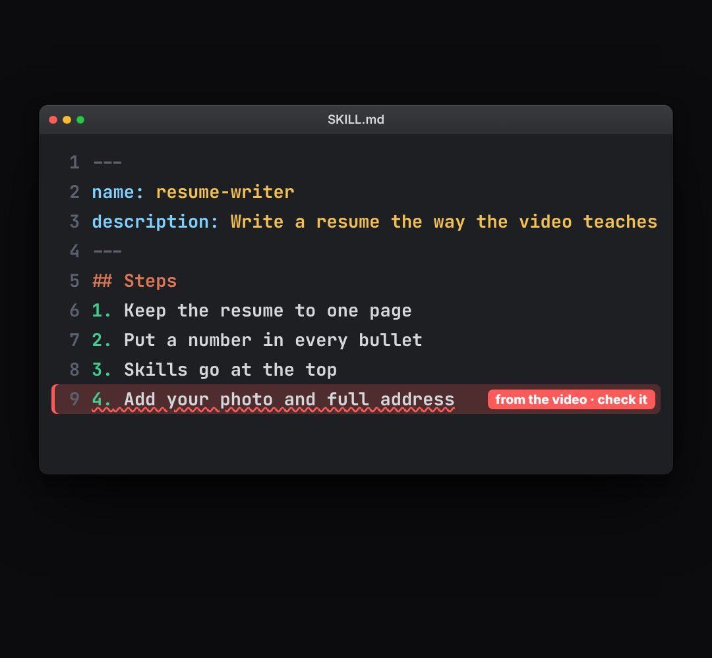

# skill-file

A skill being written: an editor window with SKILL.md (front matter, then numbered steps) typed line by line with syntax colours, a "saved to …" toast, then lines read one by one and one line flagged as wrong (red, wavy underline, a warning tag).

- `opts`: { name: "resume-writer", desc, steps: ["…"], title: window title, path: "~/.claude/skills/resume-writer/", w, h, top, size: font px, flag: text of the warning tag }
- `state`: { show: 0..1, typed: 0..1 (how much of the file is written), saved: 0..1 (toast), read: 0..steps (steps read so far), bad: index of a step that is wrong (omit = none), badP: 0..1 (the flag draws on) } · api: frame(t, state)

Use: `const b = KF.make("skill-file", hostElement, opts);` then `b.frame(t, state)` on every seek.
Working example: `demo.js` (watch it with `../gallery.html?only=skill-file`). Used in the LEARN reel (studio/reels/learn).
