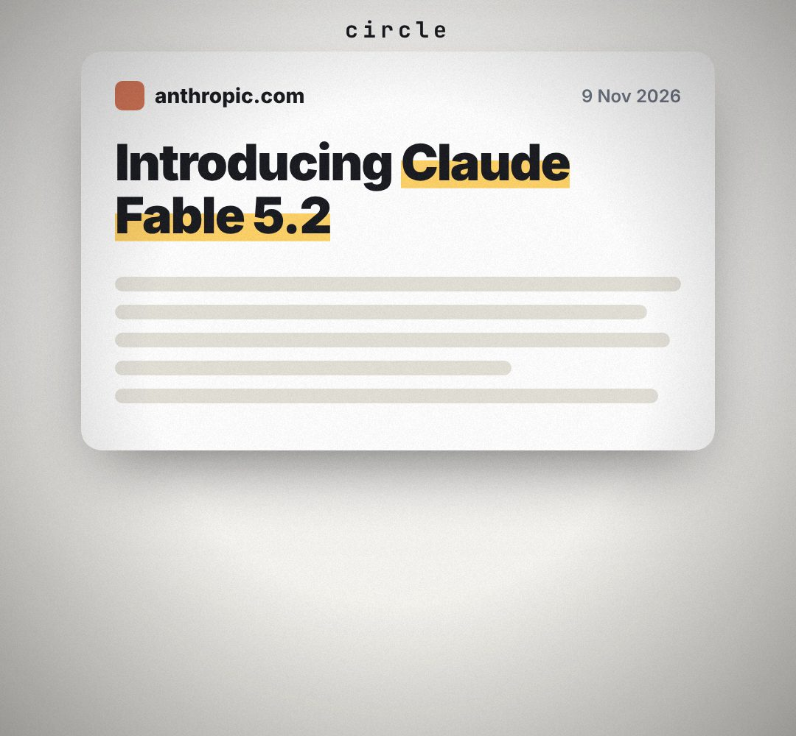

# stage-flip

The background changes between dark and light to mark a new chapter (light = real screens, dark = diagrams).

- mode "circle" (default): the light grows from a point as a circle with a soft glowing rim and a ripple ring.
- mode "turn": the whole stage turns over on its vertical axis like a card, with depth shading; your content hosts can follow with `turn(state)`.
- `opts`: { light: colour, dark: colour, origin: [x, y] in host px, mode: "circle"|"turn" }
- `state`: { p: 0..1 (0 = dark, 1 = light), origin } · api: frame(t, state) · isLight(state) → true once most of the stage is light · turn(state) → CSS transform for content during a "turn"
- Put its host BEHIND your content (first child of the stage).

Use: `const b = KF.make("stage-flip", hostElement, opts);` then `b.frame(t, state)` on every seek.
Working example: `demo.js` (watch it with `../gallery.html?only=stage-flip`).
