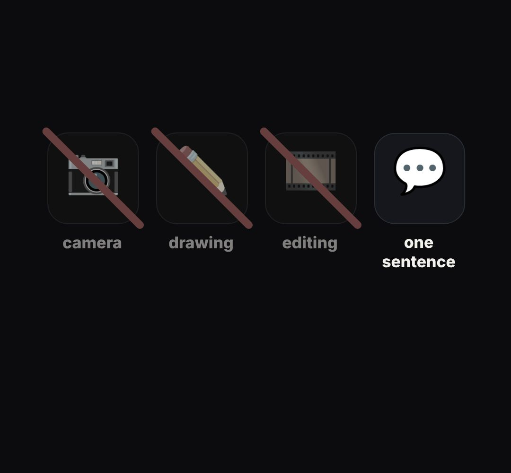

# strike-row

A row of things, each crossed out in red ("no camera, no drawing, no editing"), or ticked in green.

- `opts`: { items: [{ icon: emoji / short text, label, at: time it appears, strike: time it gets crossed (omit = stays), tick: time it gets a green tick }], size, top }
- `api`: frame(t)

Use: `const b = KF.make("strike-row", hostElement, opts);` then `b.frame(t, state)` on every seek.
Working example: `demo.js` (watch it with `../gallery.html?only=strike-row`).
