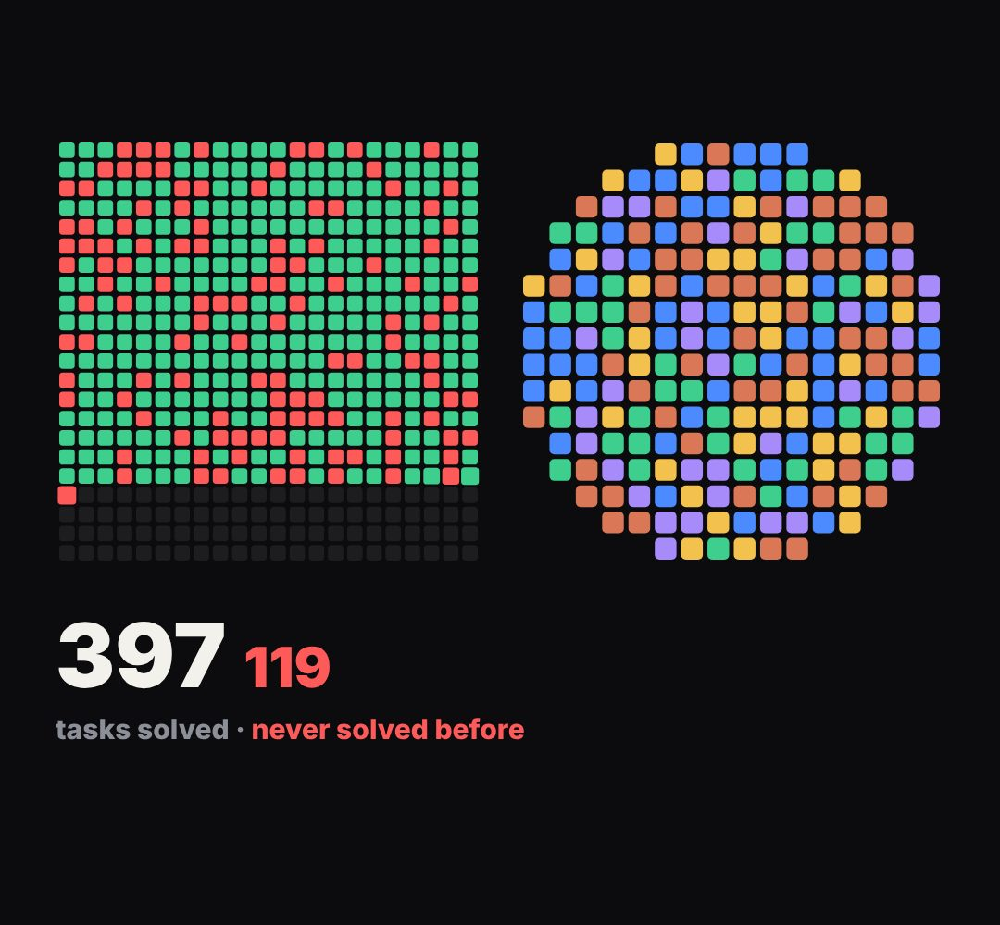

# tile-map

a board of small tiles that fill in (test results, chips on a wafer, seats, days, pixels, "N of them").

- `opts`: { cols, rows, gap, mask: "rect"|"circle", order: "scan"|"random"|"center", colors: [..] (good tiles), bad: colour, radius }
- `state`: { fill: 0..1 (how many are on), bad: 0..1 share of the on-tiles that are bad, sweep: 0..1 (a bright scan line crossing the board), dim: 0..1 }
- `api`: frame(t, state) · count(state) → { on, bad, total } (drive a counter with it) · cell(i) → [x, y, size] host pixels

Use: `const b = KF.make("tile-map", hostElement, opts);` then `b.frame(t, state)` on every seek.
Working example: `demo.js` (watch it with `../gallery.html?only=tile-map`).
