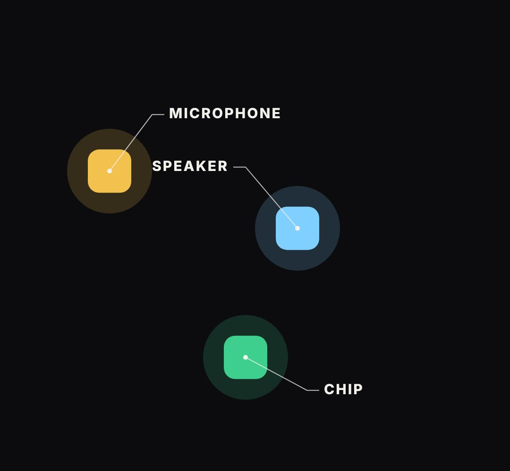

# tracked-labels

Small caps labels with a pointer line that stay glued to moving things.

- `opts`: { size: font px, color, labels: [{ text, at: time it appears, out: time it leaves, anchor: [x, y] | (t) => [x, y], dx, dy: where the text sits relative to the anchor }] }
- `api`: frame(t)

Use: `const b = KF.make("tracked-labels", hostElement, opts);` then `b.frame(t, state)` on every seek.
Working example: `demo.js` (watch it with `../gallery.html?only=tracked-labels`).
