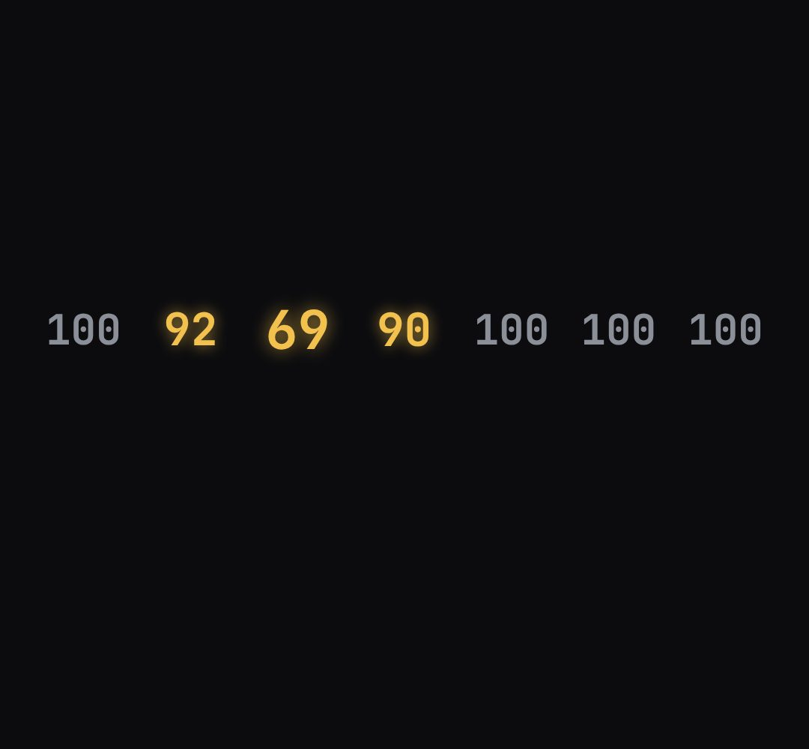

# value-strip

a row of live numbers (sensor readings, prices, scores). Cells roll to new values and light up while they differ from the base.

- `opts`: { n: cells, base: resting value, size: font px, unit: "" , hot: colour when changed, keys: [{ t, values: [..] | fn(i) }] (optional timeline) }
- `state`: { values: [..] } (optional; overrides keys) · api: frame(t, state)

Use: `const b = KF.make("value-strip", hostElement, opts);` then `b.frame(t, state)` on every seek.
Working example: `demo.js` (watch it with `../gallery.html?only=value-strip`).
