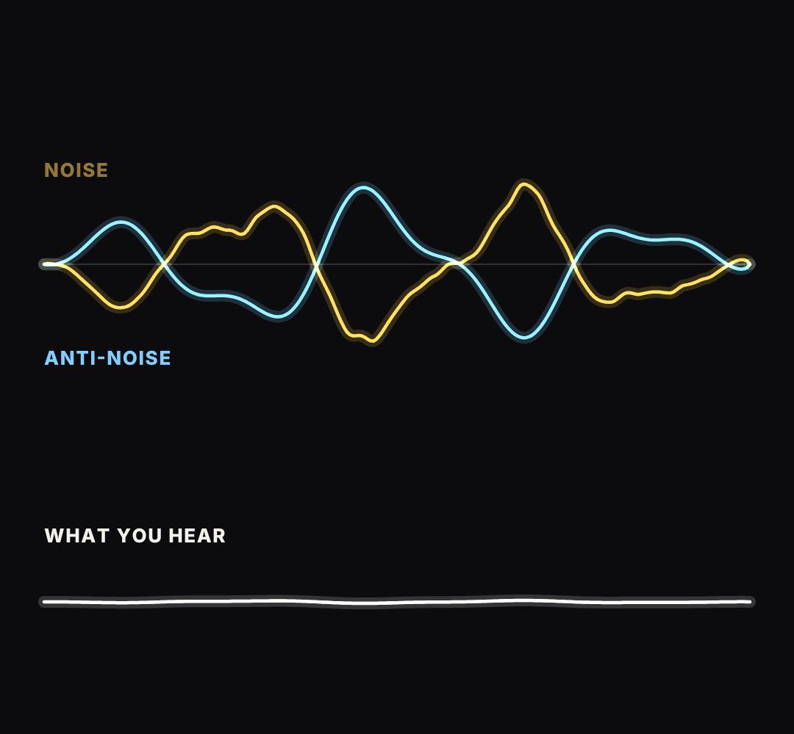

# wave-cancel

One wave, its opposite, and what is left when they meet (noise cancelling, interference, "two things that cancel out").

- `opts`: { labels: ["noise", "anti-noise", "what you hear"], colors: [a, b, sum], freq, amp }
- `state`: { a: 0..1 size of wave A, b: 0..1 size of the opposite wave, merge: 0..1 (the two lanes slide together), sum: 0..1 show the result lane, speed }
- `api`: frame(t, state)

Use: `const b = KF.make("wave-cancel", hostElement, opts);` then `b.frame(t, state)` on every seek.
Working example: `demo.js` (watch it with `../gallery.html?only=wave-cancel`).
