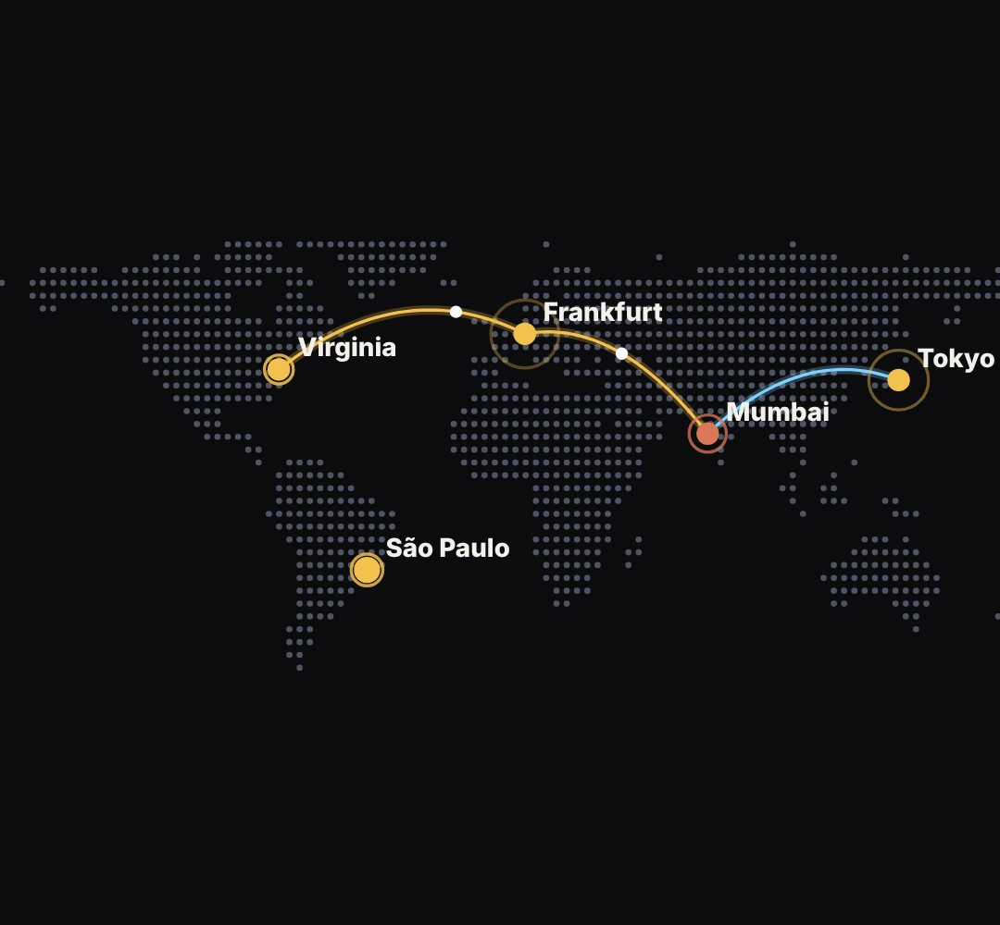

# world-map

A dotted world map with real coastlines (the dots follow actual country outlines) with cities and routes that light up (CDN, servers, "your request travels from A to B", users everywhere).

- `opts`: { cities: [{ name, lon, lat, color, at }], routes: [{ from, to, at, color }] (indexes into cities), dot: colour, label: true }
- `state`: { show: 0..1 (the map dots arrive), zoom: 1.., focus: city index } · api: frame(t, state) · xy(lon, lat) → [x, y] host pixels

Use: `const b = KF.make("world-map", hostElement, opts);` then `b.frame(t, state)` on every seek.
Working example: `demo.js` (watch it with `../gallery.html?only=world-map`).
